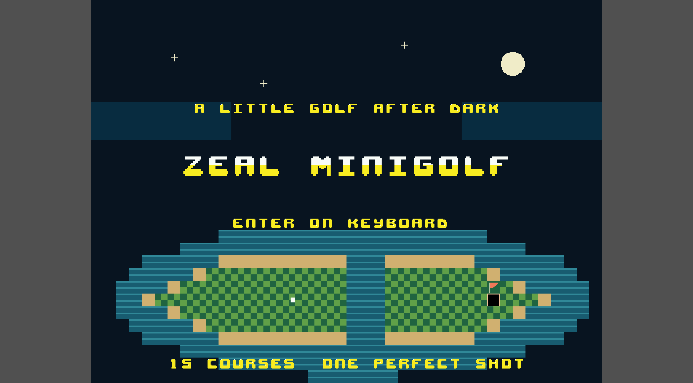
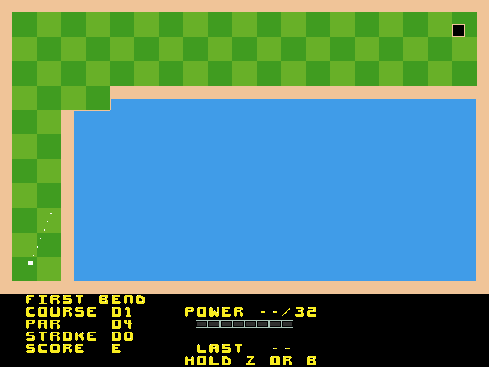
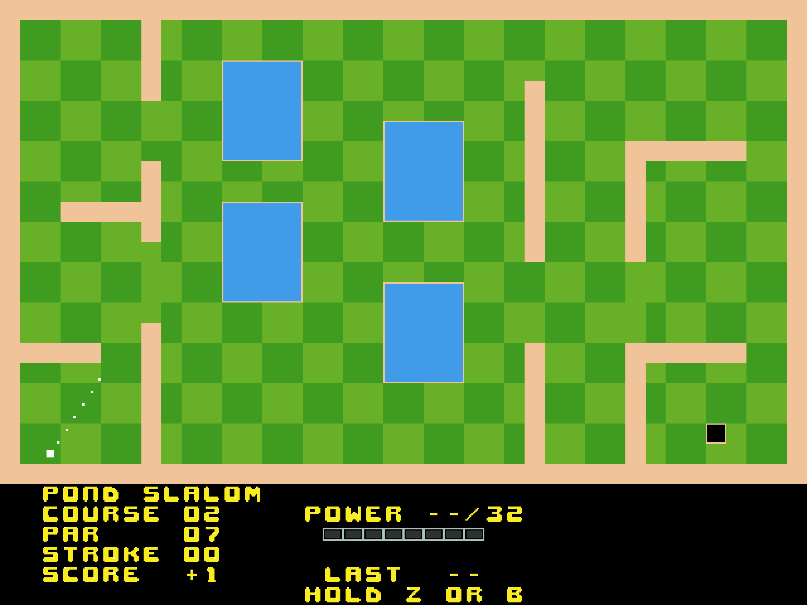

[](https://opensource.org/licenses/Apache-2.0)

# zeal-minigolf

zeal-minigolf is a miniature golf game for the Zeal 8-bit Computer, featuring **15 unique courses**, ramps, water hazards and diagonal banks.

It runs at **640×480 @8bpp**.

## Screenshots

| Splash Screen | First Bend | Pond Slalom |
| - | - | - |
|  |  |  |

<!-- Keep the screenshots folder in the repository alongside this README. -->

## Rules

- Get the ball into the hole using as few strokes as possible.
- **Par** is the target number of strokes for the current course.
- **Score** is your running total relative to par: `E` means even par, `-` means under par and `+` means over par.
- Walls and diagonal banks bounce the ball. Ramps launch it upward or rightward and can help you cross water. Walls and banks remain solid during a jump.
- Landing in water returns the ball to its position before the shot. That shot counts, with no additional penalty.
- Complete all 15 holes to see your final score. The summary stays on screen until you choose to continue or replay.

## Controls

- `ENTER` or SNES `START`: start from the splash screen.
- `LEFT` / `RIGHT` or SNES D-pad: aim.
- Hold `SPACE` / `Z` or SNES `B`: increase shot power.
- Release the shot button: hit the ball.
- `X` or SNES `A`: cancel charging without spending a stroke.
- `SPACE` / `Z` or SNES `B`: continue after a hole or replay after the final hole.
- `RIGHT_SHIFT` or SNES `SELECT`: quit.

The power meter holds at **FULL**; it does not cycle back to zero. **LAST** and the small marker show the previous shot's power. Soft sounds mark charging milestones and full power. Release the shot button after cancelling before starting another shot.

Keyboard arrows take control of aiming. To switch back to a controller after using the keyboard arrows, press SNES `START`.

## Game Flow

1. Press `ENTER` or SNES `START` at the flashing **PRESS START TO PLAY** prompt.
2. Aim, hold the shot button to choose power, then release to shoot.
3. Read the hole summary and press the shot button to move to the next course.
4. After hole 15, read your final score and press the shot button to play again.

## Build

Build from the project directory using ZDE, which supplies the Docker build environment:

```sh
zde cmake
```

The playable binary is **`bin/zgolf`**. Load it in Zeal Native Emulator or run it on your Zeal 8-bit Computer.

## Editing the Game

Open `assets/minigolf.tiled-project` in Tiled:

- `assets/minigolf.tmx` contains the 15 courses.
- `assets/splash.tmx` contains the splash artwork, lettering, blinking prompt and ball path.
- `assets/minigolf.aseprite` is the shared indexed atlas. The splash and HUD reuse its letters; there is no separate splash alphabet.

After editing the Aseprite atlas, export it from Aseprite as the indexed `assets/minigolf.gif`, preserving its palette and tile layout. Run `zde cmake`; the standard SDK `gif2zeal.py` automatically converts that GIF into game assets. Map changes compile automatically. See [EDITING.md](./EDITING.md) for the tile IDs and animation controls.

## Attribution

- Author: Zingot Games
- License: CC-BY 4.0
- Source: https://opengameart.org/content/bitmap-font-pack
- A few changes to the original assets have been made including the color palette.

## Editing game settings

The build uses the SDK's GIF/Tiled converters. Fixed gameplay and animation settings live in `src/course_settings.c` (course names, par and tee/hole positions) and `src/splash_settings.h` (prompt and ball animation). No project metadata generator is required. Tiled objects are reference guides; moving one does not change the corresponding C settings automatically.
